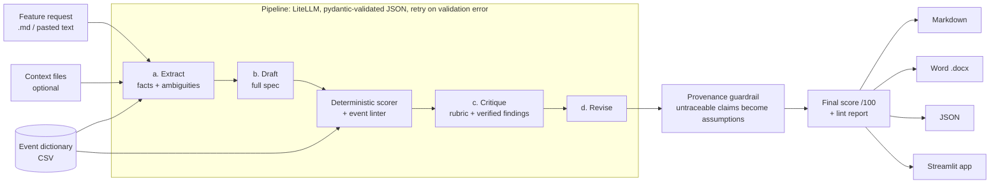

# Tech Spec Agent

   <!-- replace with your CI badge: https://github.com/saranyabalantrapu123-cmd/tech-spec-agent -->

**An LLM agent that turns a feature request into a structured, testable technical spec, with an analytics tracking plan, and scores the result with a deterministic rubric.**

## Why this matters

Requests usually reach engineering as a paragraph in a ticket or a Slack thread. Turning that into a spec engineering, QA and analytics can build from takes hours of manual writing. Quality also depends on who wrote it: some specs have acceptance criteria, some say "make it fast", and some forget instrumentation until after launch. Then the dashboard can't answer the question the feature was built for.

This agent addresses that:

- **Consistent spec quality.** Every spec has the same sections: user stories with Given/When/Then criteria, numbered FR/NFR requirements, a typed tracking plan, rollout/experiment plan, test plan, risks and open questions. Each one is scored against the same 100-point rubric.
- **Faster drafting.** A first full draft takes seconds. People spend their time reviewing and deciding, not formatting.
- **Fewer ambiguous requirements reaching engineering.** Vague words ("fast", "intuitive", "etc.") are flagged. Gaps become open questions with an owner. Anything the request didn't say is labelled as an assumption, never presented as a product fact.
- **Instrumentation designed up front.** Events follow one naming convention, carry typed properties, map to success metrics and get linted against the existing event dictionary. Duplicate events, naming drift and property-type conflicts are caught before they split a funnel.

The idea re-creates, from scratch and with synthetic data, an AI spec generator I built and rolled out org-wide, which cut manual spec-writing effort. All brands and data here are fictional (*Nimbus Wireless*, *Nimbus Prepaid*).

## Demo


> Add your recording here (`docs/demo.gif`). Run `make app`, pick an example, click **Generate spec**.

Sample outputs, generated offline and labelled as such, are in [`examples/outputs/`](examples/outputs/). Each example comes as Markdown, Word and JSON, e.g. [`plan_comparison.md`](examples/outputs/plan_comparison.md).

## Architecture



## Quickstart

Offline demo: no API key, no network, deterministic rule-based output.

```bash
make setup     # pip install --break-system-packages -r requirements.txt
make demo      # writes md/docx/json specs for 3 examples to examples/outputs/
make app       # Streamlit UI at http://localhost:8501
```

With a real model (any LiteLLM model string):

```bash
export ANTHROPIC_API_KEY=...                       # or OPENAI_API_KEY with LLM_MODEL=openai/...
export LLM_MODEL=anthropic/claude-sonnet-4-5       # default
python -m spec_agent generate examples/inputs/trade_in_estimate.md \
    --format md,docx,json --event-dictionary examples/inputs/event_dictionary.csv
make eval                                          # full pipeline vs single-pass baseline
```

Other commands:

```bash
python -m spec_agent score examples/outputs/plan_comparison.json --min-score 90   # CI gate
python -m spec_agent lint  examples/outputs/plan_comparison.json \
    --event-dictionary examples/inputs/event_dictionary.csv
python -m spec_agent generate my_request.md --context notes.md --single-pass       # baseline
make test      # 54 offline tests
make smoke     # headless Streamlit start + health check
docker build -t tech-spec-agent . && docker run -p 8501:8501 tech-spec-agent
```

With no key (or `LLM_MODEL=mock`), every entry point prints **"Running in offline demo mode (no LLM key) — outputs are rule-based"**. Generated documents carry the same label.

## How it works

**Pipeline** ([`spec_agent/pipeline.py`](spec_agent/pipeline.py)). Each stage is one structured LLM call validated against a pydantic model ([`schema.py`](spec_agent/schema.py)). Models reject unknown keys. On a parse or validation error, the exact error is sent back to the model and the call is retried, up to 2 times ([`llm.py`](spec_agent/llm.py)).

| Stage | Output | Notes |
|---|---|---|
| a. Extract | `Extraction`: atomic facts (F-n) with verbatim source quotes, ambiguities, platforms, relevant dictionary events | The only allowed source of product facts |
| b. Draft | `SpecContent`: all 17 sections | Input-sourced requirements must cite F-n; additions are `source="assumption"` + A-n |
| c. Critique | `Critique`: rubric scores + issues | Grounded in the draft's deterministic score findings and lint findings |
| d. Revise | `SpecContent` | Must fix issues or raise an open question; never invent the missing fact |

**Guardrails**
- *Provenance check* (deterministic, after revise). A requirement claiming `source="input"` without citing an extracted fact is relabelled as an assumption, with a new A-n entry. A dependency not named in the request is relabelled too. Every relabel is reported.
- *Open questions over guesses.* Missing targets, eligibility rules, data sources and experiment parameters become OQ-n items with an owner and a blocking flag.
- *Token and cost tracking* per stage with a real model (LiteLLM `usage` + `completion_cost`), shown in the CLI and the app.

**Deterministic quality scorer** ([`scorer.py`](spec_agent/scorer.py), no LLM). Scores out of 100, with itemised findings:

| Category | Pts | Checks |
|---|---|---|
| Section completeness | 20 | 16 sections present and non-empty |
| User stories & acceptance criteria | 15 | Unique US-n IDs, a "so that", at least one full Given/When/Then, verifiable "then" |
| Requirement quality | 20 | Unique FR-n/NFR-n IDs; no vague words (unless deferred to an OQ); one requirement per statement; NFRs have a threshold; assumptions cite A-n |
| Tracking plan | 20 | snake_case `<object>_<past_tense_action>`, approved verbs, ≤50 chars, typed snake_case properties, enum values, trigger, platform, required globals (`platform`, `brand`, `session_id`); minus unresolved dictionary-lint findings |
| Consistency & traceability | 15 | Test plan only references existing events/IDs; every FR tested; every event verified; metrics use defined events |
| Ambiguity handling | 10 | Open questions exist and explain why they matter; no dangling OQ refs |

**Event-dictionary linter** ([`linter.py`](spec_agent/linter.py)). Checks against a CSV of existing events:
- existing event re-declared as new
- existing event extended without being marked `modified`
- *naming drift* (`planCompareSelected` vs `plan_compare_selected`: case, separators, plural, tense)
- *synonym drift* (`estimate`/`quote`, `tap`/`click`)
- near-duplicates with the same action
- property type conflicts
- deprecated events

**Offline MockLLM** ([`mock_llm.py`](spec_agent/mock_llm.py)). Implements the same four stages with keyword and sentence heuristics. It restates input sentences as facts, builds stories, events and tests from templates, and its "revise" step applies scorer and linter fixes. That covers splitting compound requirements, linking vague ones to open questions, fixing event status, and raising OQs for possible duplicates. It exists so the demo, app and tests run without a key. It is not a stand-in for real drafting quality.

## Evaluation

`make eval` runs every example through the **full pipeline** and a **single-pass baseline** (extract + draft, no critique/revise). For each, it reports:
- quality score
- dictionary-lint findings
- guardrail relabels
- tokens/cost
- **ambiguity recall**: the share of gaps from a hand-labelled gold set ([`evals/expected_ambiguities.json`](evals/expected_ambiguities.json), 8 per example) that show up in the spec's open questions

**Offline demo mode (rule-based MockLLM, measured):**

| Example | Single-pass score | Full-pipeline score | Ambiguity recall (single / full) | Lint errors / warnings (full) |
|---|---|---|---|---|
| ai_chat_bill_page | 96.8 | 99 | 75% / 88% | 0 / 2 |
| plan_comparison | 96 | 98.5 | 75% / 88% | 1 / 1 |
| trade_in_estimate | 97.3 | 99.5 | 75% / 75% | 0 / 1 |

How to read this:
- **High scores are expected.** The mock is written against the same conventions the scorer checks, so the structural score mostly shows the pipeline and rubric agree.
- **Recall shows real misses.** The mock never asks about device-condition grades, estimate-vs-inspection disputes, live-agent hours or line-filter values.
- **Remaining lint findings need a human.** They are open decisions, e.g. whether `ai_chat_assistant_opened` should reuse the existing `chat_assistant_opened`.

**Real model vs single-pass baseline:** *run `make eval` with your key to fill this in.* Results are written to `evals/results/<model>_results.md`.

| Example | Single-pass score | Full-pipeline score | Ambiguity recall (single / full) | Tokens | Est. cost |
|---|---|---|---|---|---|
| ai_chat_bill_page | – | – | – | – | – |
| plan_comparison | – | – | – | – | – |
| trade_in_estimate | – | – | – | – | – |

## Tech stack

Python 3.11+ · [LiteLLM](https://github.com/BerriAI/litellm) (model-agnostic; default `anthropic/claude-sonnet-4-5`) · pydantic v2 (schemas + validation/retry) · python-docx (Word export) · Streamlit · pandas · pytest · Docker

```
spec_agent/
  schema.py        pydantic models: extraction, spec, critique, score report
  conventions.py   naming rules, approved verbs, required properties, vague-word list
  llm.py           LiteLLM client, JSON validation + retry, usage/cost, offline switch
  mock_llm.py      deterministic offline implementation of all four stages
  prompts.py       stage prompts + rubric
  pipeline.py      extract -> draft -> critique -> revise, provenance guardrail
  scorer.py        deterministic /100 rubric
  linter.py        event-dictionary linter
  renderers.py     Markdown / .docx / JSON
  evaluation.py    full vs single-pass harness
  __main__.py      CLI: generate | score | lint
app.py             Streamlit UI
examples/inputs/   3 feature requests + event_dictionary.csv
examples/outputs/  offline demo outputs (md, docx, json)
evals/             gold ambiguity labels + results
tests/             pytest suite (offline)
```

## Data source + license

All inputs are synthetic and written for this project. That covers the three Nimbus Wireless feature requests and the sample event dictionary in `examples/inputs/`, plus the test fixtures. No real company, customer or product data is used. Code is released under the [MIT License](LICENSE).

## Disclaimer

Personal portfolio project built with public/synthetic data. Not affiliated with any employer.
